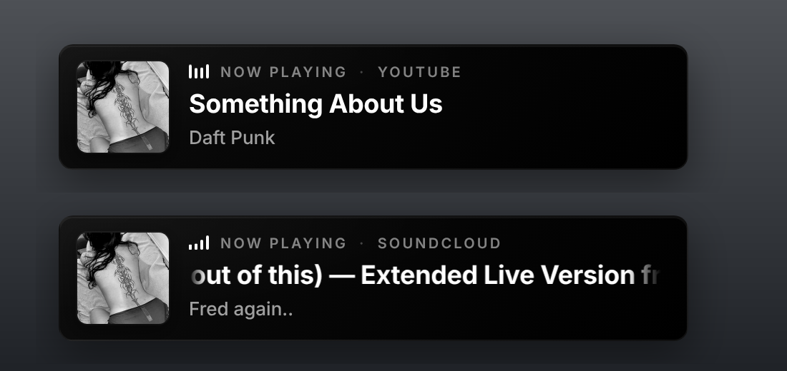

# NowPlaying for OBS

**Show the song you're playing on YouTube or SoundCloud as a clean black & white card in OBS, and let your Twitch chat ask for it with `!song`.**

Made for Twitch streamers on Windows. It runs 100% locally on your PC: no account on a third-party site, no cloud service, and **no channel bot (Nightbot, StreamElements, …) required** for `!song`. The only online connection is your own (free) Twitch developer app, used so NowPlaying can answer in your chat.

<p align="center">
  
</p>

## Features

- **Instant updates.** Change the song and the card in OBS updates right away, with a smooth crossfade.
- **Auto-detection** of the song playing in your browser on **YouTube**, **YouTube Music** and **SoundCloud**, even when the player is in another tab or you're browsing a different SoundCloud page.
- **Full song names.** Titles that are too long scroll right to left so viewers can read the whole name.
- **Black & white design:** a coal-black card with small rounded corners and your own picture shown in black and white.
- **No flicker when skipping.** Short gaps between songs are ignored, and the card fades away only after 2 s of real silence.
- **Twitch `!song`** answered by NowPlaying itself (YouTube replies include the link; SoundCloud replies show just the name).
- **Dashboard app** with a dark theme: hide-when-paused, scroll speed and change picture are applied to OBS live.
- **Runs in the tray.** Closing the window keeps it running quietly in the background. It's light on resources: the dashboard page is unloaded while hidden.
- **Privacy option:** an OBS script starts NowPlaying with OBS and closes it when OBS closes, so nothing is detected off-stream.
- **Works with Chrome, Firefox**, Edge, Brave and Opera.

## How it works

```
 Browser tab (YouTube / SoundCloud)
        │  browser extension reads the song
        ▼
 NowPlaying.exe  ── local server on 127.0.0.1:8787 (never leaves your PC)
        │                     │
        ▼                     ▼
 OBS Browser Source      Twitch chat (!song) via your own Twitch app login
```

## Setup (step by step)

### 1. Download

Download the latest **NowPlaying.zip** from [Releases](../../releases) and unzip it somewhere permanent (for example `Documents\NowPlaying`).

### 2. Start the app

Double-click **NowPlaying.exe**.

- If Windows SmartScreen says *"Windows protected your PC"*, click **More info**, then **Run anyway** (the app isn't code-signed).
- The dashboard opens. Closing it with **X** keeps NowPlaying running in the tray next to the clock. Click the tray icon to open it again, or right-click it and choose **Quit** to stop it.
- The window uses Microsoft Edge WebView2, which is built into Windows 10/11.

### 3. Install the browser extension

#### Chrome, Edge, Brave, Opera

1. Open `chrome://extensions` (Edge: `edge://extensions`, Opera: `opera://extensions`).
2. Turn on **Developer mode**.
3. Click **Load unpacked** and select the **`extension`** folder.
4. Reload any YouTube / SoundCloud tabs that were already open.

#### Firefox

Firefox only keeps extensions that Mozilla has signed. Signing is free, automatic and takes a few minutes. You only do this once (and again only if you update the extension).

1. **Give the extension your own ID.** Open `extension-firefox/manifest.json` and change
   `"id": "nowplaying@change-me-to-your-name"` to something unique, e.g. `"nowplaying@yourname"`.
   The easiest unique ID is a GUID in braces: in PowerShell run `[guid]::NewGuid()` and use `"{that-guid}"`.
   (If you skip this, Mozilla answers *"Duplicate add-on ID found"*.)
2. **Make the .xpi file.** Open the `extension-firefox` folder, select **all files inside it** (`manifest.json`, `background.js`, `content.js`, `icons`), right-click, choose **Send to**, then **Compressed (zipped) folder**, and rename the zip to `NowPlaying-firefox.xpi`.
   Zip the *contents*, not the folder itself.
3. Go to [addons.mozilla.org/developers](https://addons.mozilla.org/developers/) and log in (any Firefox account).
4. Click **Submit a New Add-on** and choose **On your own**. That keeps it private and unlisted.
5. Upload `NowPlaying-firefox.xpi`. If it asks whether you used a minifier or code generator, answer **No**, then submit.
6. Wait until the status says **Approved** (usually a few minutes; you also get an email).
7. Open **My Add-ons → NowPlaying for OBS → Manage Status & Versions**, click the version, then click the `.xpi` file. Firefox asks to install it: click **Add**.
8. Open `about:addons`, click **NowPlaying for OBS**, go to **Permissions**, and turn **all** permissions on.
9. Reload your YouTube / SoundCloud tabs.

> Just want to try it first? Open `about:debugging#/runtime/this-firefox`, click **Load Temporary Add-on…** and pick `extension-firefox/manifest.json`. It works right away but disappears when Firefox closes.

### 4. Add the overlay to OBS

1. **Sources → + → Browser**.
2. Leave **Local file** unticked and set **URL** to `http://127.0.0.1:8787/overlay`.
3. **Width 520**, **Height 130**. Clear the **Custom CSS** box.
4. Click **OK**, play a song, and position the card in your scene.

The card is invisible whenever nothing is playing or the app isn't running.

### 5. Run NowPlaying only while OBS is open (recommended)

1. Keep `obs/NowPlaying-OBS.lua` in the **same folder as NowPlaying.exe**.
2. In OBS go to **Tools → Scripts**, click **+** and choose `NowPlaying-OBS.lua`.

NowPlaying now starts quietly in the tray when OBS starts and closes a few seconds after OBS closes. While it isn't running, the extension sends nothing anywhere, so what you watch off-stream stays private.

### 6. Twitch `!song` (optional)

NowPlaying answers `!song` in your chat itself. Nightbot and StreamElements run on their own servers and can't see your PC, so they aren't used.

1. In the dashboard, open **Twitch !song** at the bottom.
2. Go to [dev.twitch.tv/console/apps](https://dev.twitch.tv/console/apps), log in and click **Register Your Application**:
   - **Name:** anything, e.g. `NowPlaying-yourname`
   - **OAuth Redirect URLs:** `https://localhost` (required by Twitch but not used; make sure there's no extra empty row)
   - **Category:** Chat Bot
   - **Client Type:** **Public**
3. Click **Create**, then **Manage**, and copy the **Client ID**. You don't need a Client Secret.
4. Paste the Client ID into NowPlaying and click **Connect Twitch**.
5. `twitch.tv/activate` opens with a code. Check it matches the one in the app, log in with the account that should answer (your own or a bot account) and click **Authorize**.
6. The app shows **Listening in #yourchannel**. Type `!song` in your chat.

Example replies:

```
🎵 Daft Punk - Something About Us → https://youtu.be/…
🎵 Fred again.. - Delilah
```

You can change the command, the reply text, the "nothing is playing" text and the channel in the app.
Reply variables: `{song}` `{title}` `{artist}` `{url}` `{source}` `{user}`. Replies are limited to one every 5 seconds.
If you had a `!song` command in Nightbot / StreamElements, delete it so chat doesn't get two answers.

The login renews itself. It's stored only on your PC in `%APPDATA%\NowPlaying\config.json` and is never in this repository.

## Dashboard settings

| Setting | What it does |
| --- | --- |
| Hide when paused | The OBS card disappears while the song is paused |
| Scroll speed | Slow / Normal / Fast for long song names |
| Change picture | Opens the folder with `cover.jpg` selected. Replace it with your own image (`.jpg`, `.png`, `.webp`, `.gif`) and OBS updates within 2 seconds, shown in black and white automatically |
| Copy !song link | Copies `http://127.0.0.1:8787/api/now-playing?format=text` |

The current song is also written to `nowplaying.txt` next to the exe, for an OBS Text source or other tools.

## Local API

| Endpoint | Returns |
| --- | --- |
| `GET /overlay` | The OBS overlay page |
| `GET /api/now-playing` | Current song as JSON |
| `GET /api/now-playing?format=text` | `Artist - Title` |
| `GET /events` | Server-Sent Events stream used by the overlay |

Everything listens on `127.0.0.1` only, so nothing is reachable from other computers.

## Troubleshooting

- **The card doesn't show in OBS:** check that the dashboard shows the song. If it doesn't, reload the YouTube / SoundCloud tab and check the extension is enabled (in Firefox, that all permissions are on). Make sure the OBS source uses the URL, not *Local file*.
- **"Duplicate add-on ID found" on Mozilla:** change the `id` in `extension-firefox/manifest.json` (step 3, Firefox, point 1).
- **"Redirect URIs must use HTTPS protocol" on Twitch:** use `https://localhost` and remove any extra empty redirect row.
- **Starting NowPlaying.exe twice** just opens the existing window.
- **Port 8787 is taken:** run `NowPlaying.exe -port 9000`, then change the port in `extension*/background.js` and in the OBS URL.

## Project structure

```
app/                 Windows app: local server, dashboard window, tray, Twitch chat
  web/               dashboard (app.html), OBS overlay (overlay.html), default cover
extension/           browser extension for Chrome / Edge / Brave / Opera
extension-firefox/   the same extension packaged for Firefox
obs/                 OBS Lua script (start/stop NowPlaying with OBS)
docs/images/         screenshots
```

## Built with

- **Go:** the Windows app, local web server, tray icon and Twitch chat bot (WebView2 window via [go-webview2](https://github.com/jchv/go-webview2))
- **JavaScript:** the browser extension (Manifest V3), the overlay and the dashboard logic
- **HTML & CSS:** the OBS overlay and the dashboard design
- **Lua:** the OBS script

## Keywords

OBS, now playing, Twitch, streamer, song overlay, `!song` command, YouTube, SoundCloud, browser source, Windows, Chrome extension, Firefox add-on
